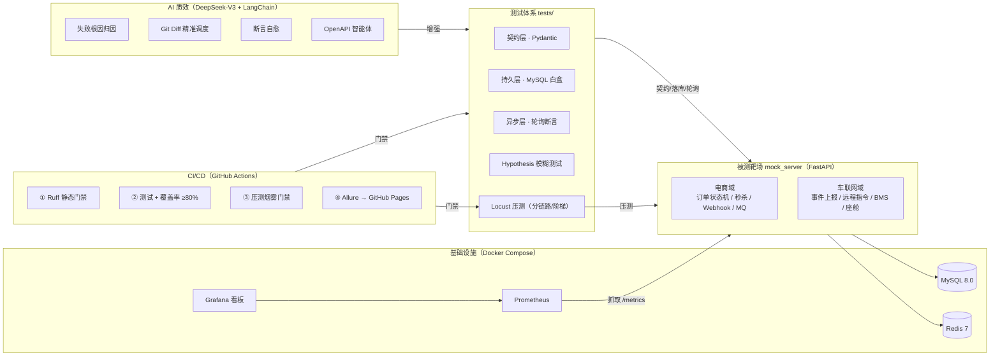
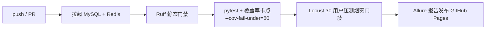

# 🚀 AutoQA-Lab：微服务全链路自动化测试与 AI 质效实验室

[](https://github.com/ARieS719/autoqa-lab/actions)
[]()
[]()
[]()
[]()

> **面向高并发交易与车联网场景的测开工程实验室**：从被测系统、三层白盒自动化、性能压测调优，到 CI 质量门禁与 LLM 质效工具，形成完整闭环。**本文所有数字均附原始运行输出，可一键复现。**

---

## 📖 目录

1. [系统架构](#-系统架构)
2. [核心竞争力](#-一页看懂项目竞争力)
3. [核心模块](#-核心模块)
4. [实测证据](#-实测证据全部可复现)
5. [快速开始](#-快速开始)
6. [项目目录结构](#-项目目录结构)
7. [设计决策 FAQ](#-设计决策与面试高频问答)
8. [安全声明](#️-安全声明)

---

## 🗺️ 系统架构



---

## 🎯 一页看懂项目竞争力

| 测开能力维度 | 项目落点 | 面试可展开话题 |
| :--- | :--- | :--- |
| **接口自动化** | Pydantic 契约 + MySQL 白盒落库 + 轮询断言三层体系 | 断言金字塔 / 契约测试 / 数据清理闭环 |
| **并发与幂等** | 支付 CAS 原子条件更新、10 线程并发防重实测 | 重复扣款防护 / `UPDATE ... WHERE status='PENDING'` |
| **性能测试** | 分链路 + 阶梯加压压测方案，两个真实调优案例 | 瓶颈定位方法论 / 锁 vs 服务端原子化 |
| **中间件知识** | Redis 分布式锁、Lua 原子扣减、List 模拟 MQ | 防超卖方案选型 / 最终一致性 / 削峰 |
| **安全测试** | HMAC-SHA256 验签、防重放、SQL 注入专项 | Webhook 安全 / 幂等去重 / 越权防护 |
| **CI/CD 工程化** | 四道门禁：Lint → 测试+覆盖率 → 压测 smoke → Allure | 质量红线设计 / 流水线编排 |
| **可观测性** | Prometheus 指标 + Grafana 预置看板 | 压测-监控联动定位瓶颈 |
| **AI 质效** | 失败归因 / Git Diff 调度 / 自愈引擎（无 Key 优雅降级） | ReAct / 测试提效 ROI |
| **业务域建模** | 电商 + 车联网双域（VIN 校验、指令状态机） | 车企云平台测试设计 |

---

## 🏗️ 核心模块

### 1. 被测靶场（电商 + 车联网双域，23 接口 / 7 张表）

**电商域** — 高并发交易与异步通知：

| 链路 | 关键技术 | 防御要点 |
| :--- | :--- | :--- |
| 订单状态机 | `PENDING → PAID / CANCELLED` | 支付/取消 **CAS 条件原子更新**，并发重复支付仅一人成功 |
| 秒杀防超卖 | Redis 原子库存 + Lua 脚本 | 一条 Lua 完成「检查+扣减+计数」，无锁排队无超时；slow 模式保留分布式锁反面教材 |
| Webhook 回调 | HMAC-SHA256 验签 | 时间戳防重放（±300s）+ `SET NX` 幂等去重 + 先 ACK 后台异步流转 |
| MQ 积分发放 | Redis List 模拟队列 + Hash 账本 | 最终一致性可被轮询断言验证 |

**车联网域** — 面向车企车云平台：车辆事件上报（17 位 VIN 强校验）、远程指令状态机（CAS 防重复执行）、BMS 告警、座舱偏好 UPSERT；`charging_orders` / `ota_tasks` 扩展位已预留。

### 2. 三层白盒自动化测试体系（32 用例 + 200 组模糊数据）

```
┌─ 契约层 ──── Pydantic 强校验 HTTP 响应结构与字段类型
├─ 持久层 ──── PyMySQL 穿透校验落库状态，QA_AUTO_ 前缀 + Teardown 自动清库
└─ 异步层 ──── poll_until 轮询断言 + ThreadPoolExecutor 瞬时并发冲击
```

覆盖：订单状态机（YAML 数据驱动）、并发支付幂等（10 线程恰 1 成功）、秒杀防超卖（10 线程 0 超卖）、Webhook 验签异步流转、MQ 最终一致性、7 类安全攻击、200 组 Hypothesis 畸形 Payload、车联网四链路。

### 3. 性能压测体系（分链路 + 阶梯加压）

`PERF_PROFILE=mixed | seckill | trade` 三链路隔离度量；50→500 并发阶梯；库存 50,000 保证扣减链路全程受压。完整报告见 [PERF_REPORT.md](PERF_REPORT.md)。

### 4. CI/CD 四道门禁 + AI 质效工具链



`ai_agent/`：失败归因 / Git Diff 精准调度 / 断言自愈 / OpenAPI 智能体，全部「有 Key 增强、无 Key 降级」。

---

## 📊 实测证据（全部可复现）

> 以下均为 2026-10-26 本机实测原始输出（Windows + Docker Desktop，MySQL 8.0 / Redis 7 容器，FastAPI 单 Worker）。完整阶梯数据与瓶颈分析见 [PERF_REPORT.md](PERF_REPORT.md)。

### 证据 1：全量测试与覆盖率（pytest 原始输出）

```
Name                      Stmts   Miss  Cover   Missing
-------------------------------------------------------
mock_server\__init__.py       0      0   100%
mock_server\app.py          280     26    91%   68, 109-110, 186, 191-192, 197-198, 202-204, 250, 265, 289, 356, 381-382, 408-411, 413, 431-434, 436
mock_server\deps.py           9      0   100%
mock_server\vehicle.py      120     10    92%   130, 139-151
-------------------------------------------------------
TOTAL                       409     36    91%
Required test coverage of 80% reached. Total coverage: 91.20%
=========================== 32 passed, 1 warning in 11.20s =================
```

> 32 个测试条目 + 200 组 Hypothesis 自动生成模糊数据；CI 硬门禁 80%，实测 91.20%；唯一 warning 为第三方库 starlette 内部弃用提示（anyio 别名），非项目代码。

### 证据 2：静态规范门禁（ruff 原始输出）

```
(venv) PS D:\Microsoft VS Code\QA_Automation_Project> venv\Scripts\python.exe -m ruff check .
All checks passed!
```

### 证据 3：调优前后对比（slow vs fast，100 并发 / 60s，Locust 原始输出节选）

**优化前 `PERF_MODE=slow`（粗粒度分布式锁 + 锁内阻塞 I/O）**：

```
POST [秒杀洪峰] 分布式锁抢购   815  620(76.07%) |   2522       1    3644   3200 |   13.69
Response time percentiles:  50% 3200 | 90% 3300 | 99% 3400 | 100% 3600
Error report:  578 次 "秒杀接口异常: 500"（等锁超时）+ 42 次连接错误
```

**优化后 `PERF_MODE=fast`（Redis Lua 原子扣减）**：

```
POST [秒杀洪峰] 分布式锁抢购  5597     0(0.00%) |    286       3    1097    310 |   94.28
Response time percentiles:  50% 310 | 90% 390 | 99% 480 | 100% 1100
Error report: 无
```

| 指标 | slow（优化前） | fast（优化后） | 改善 |
| :--- | :---: | :---: | :---: |
| 秒杀 Med / TP99 | 3200 / 3400 ms | **310 / 480 ms** | 10 倍 / -86% |
| 秒杀失败率 | 76.07% | **0.00%** | 彻底消除 |
| 混合链路吞吐 | 75 req/s | **151 req/s** | 2 倍 |
| 超卖 | 0 | 0 | 账实一致 |

### 证据 4：阶梯压测暴露并修复 Redis 连接池缺陷（500 并发档）

**修复前**：500 并发档出现 12.34% 失败，服务端日志定位到 `MaxConnectionsError: Too many connections`（redis-py 5.x 异步连接池默认上限仅 100，压测需同时占用 500+ 连接）。

```
POST [秒杀洪峰] 分布式锁抢购  21390  2639(12.34%) |    955       1   10903    530 |  358.28
Error report: 1256 次 500（MaxConnectionsError）+ 1383 次连接错误
```

**修复后**（连接池 100 → 1000 + socket 超时保护）：

```
POST [秒杀洪峰] 分布式锁抢购  33835     0(0.00%) |    697       4    3904    590 |  567.46
Error report: 无
```

### 证据 5：秒杀链路阶梯数据（50→500 并发，库存 50,000，全档 0 失败）

| 并发 | RPS | TP50 | TP90 | TP99 | 失败率 |
| :---: | :---: | :---: | :---: | :---: | :---: |
| 50 | 325 | 45 | 97 | 130 | 0% |
| 100 | 325 | 200 | 260 | 310 | 0% |
| 200 | 312 | 520 | 620 | 680 | 0% |
| 300 | 316 | 810 | 930 | 1000 | 0% |
| 500 | 568 | 590 | 1200 | 1500 | 0% |

> 100→300 并发段吞吐停在 ~320 RPS 平台：瓶颈从「并发不足」转为「单 Worker 处理能力」，拐点清晰可见。

### 证据 6：扣减 / 拦截链路分层 + 混合链路过载拐点

| 链路 | 场景 | RPS | TP99 | 失败率 |
| :--- | :--- | :---: | :---: | :---: |
| 扣减链路 | Lua 原子扣减（库存充足） | 568（500 并发） | 1500 ms | 0% |
| 拦截链路 | Fast-Fail（库存清零，100 并发） | 370 | 270 ms | 0% |
| 混合链路 | 下单/支付/秒杀（100 并发） | 151 | 480 ms | 0% |
| 混合链路 | 300 并发（过载拐点） | **112（反降）** | 9900 ms | 0% |

> 拦截链路服务端日志实测单请求 5~30ms（应用健康），300 并发混合链路过载后吞吐反降——两类数据共同刻画了单 Worker 环境的容量画像。详见 [PERF_REPORT.md](PERF_REPORT.md)。

---

## 🚀 快速开始

### 前置要求
- Docker Desktop（提供 MySQL 8.0 / Redis 7 / Prometheus / Grafana）
- Python 3.11（仓库本地环境含 `venv`）

### ① 拉起基础设施（首启自动建 7 张表）

```bash
docker compose up -d --wait test-db redis-cache
docker compose up -d                    # 可选：附带 Prometheus + Grafana 监控
```

### ② 启动被测靶场

```bash
venv\Scripts\python.exe -m uvicorn mock_server.app:app --host 0.0.0.0 --port 8000
# 探活 http://127.0.0.1:8000/health ｜ Swagger 文档 http://127.0.0.1:8000/docs
```

### ③ 全量测试 + 覆盖率门禁

```bash
venv\Scripts\python.exe -m pytest tests/ --cov=mock_server --cov-report=term-missing --cov-fail-under=80 --alluredir=allure-results
```

### ④ 压测实验

```bash
# 混合链路
venv\Scripts\python.exe -m locust -f tests/locustfile.py --headless -u 100 -r 10 -t 60s --host http://127.0.0.1:8000
# 纯秒杀阶梯压测（50/100/200/300/500 并发）
$env:PERF_PROFILE="seckill"
foreach ($u in @(50,100,200,300,500)) { venv\Scripts\python.exe -m locust -f tests/locustfile.py --headless -u $u -r 20 -t 60s --host http://127.0.0.1:8000 --csv "perf/seckill_u$u" }
Remove-Item Env:\PERF_PROFILE
# slow 对照：$env:PERF_MODE="slow" 重启靶场后重复任一档
```

### ⑤ AI 质效工具链（`.env` 配置 `OPENAI_API_KEY`，未配置自动降级）

```bash
venv\Scripts\python.exe ai_agent/smart_scheduler.py    # Git Diff 智能调度
venv\Scripts\python.exe ai_agent/openapi_tester.py     # OpenAPI ReAct 智能体
venv\Scripts\python.exe ai_agent/self_healer.py        # 断言自愈（演示见 examples/healing_demo）
venv\Scripts\python.exe ai_agent/failure_analyzer.py   # 失败归因自测
```

---

## 📂 项目目录结构

```text
autoqa-lab/
├── .github/workflows/main.yml      # CI/CD：Lint → 测试+覆盖率 → 压测 smoke → Allure 发布
├── ai_agent/                       # AI 测开提效工具链（DeepSeek-V3 + LangChain）
│   ├── failure_analyzer.py         # 失败堆栈与服务端日志智能归因
│   ├── openapi_tester.py           # OpenAPI ReAct 智能体 + SQL 白盒穿透
│   ├── self_healer.py              # 断言失效自动修复（备份 + 护栏 + 回归）
│   └── smart_scheduler.py          # Git Diff 精准回归调度（规则兜底）
├── db_init/                        # MySQL 初始化 SQL（容器 entrypoint 与服务自愈共用）
│   ├── 01_create_tables.sql        # 电商订单表 + 联合索引
│   └── 02_vehicle_tables.sql       # 车联网 6 大核心业务表
├── examples/healing_demo/          # AI 自愈演示素材
├── grafana/                        # Prometheus 数据源 + 压测监控看板
├── mock_server/                    # FastAPI 双域被测靶场
│   ├── app.py                      # 电商域：订单/秒杀/Webhook/MQ/造数工具
│   ├── vehicle.py                  # 车联网域：事件/指令/BMS/座舱
│   └── deps.py                     # 共享依赖（DB 连接 + Token 鉴权）
├── tests/                          # 测试与压测套件（10 个测试文件 + locustfile）
├── config.py                       # 统一配置中心（pydantic-settings）
├── init_db.py                      # 一键建表脚本
├── pyproject.toml                  # Pytest + Ruff 工程化配置
├── PERF_REPORT.md                  # 性能压测报告（阶梯数据/链路分层/调优案例）
├── Dockerfile                      # 靶场容器镜像
├── docker-compose.yml              # MySQL/Redis/Prometheus/Grafana 编排
├── prometheus.yml                  # 监控采集配置
└── requirements.txt                # 依赖清单（锁定版本）
```

---

## ⚠️ 安全声明

本仓库为**测试教学靶场**：登录口令与 Token 为演示用途硬编码，仅用于验证鉴权链路；
生产环境必须接入真实 IAM。请勿将 `.env` 中真实密钥提交至 Git（`.gitignore` 已防护，
若密钥曾进入 Git 历史请立即在平台侧轮换）。
