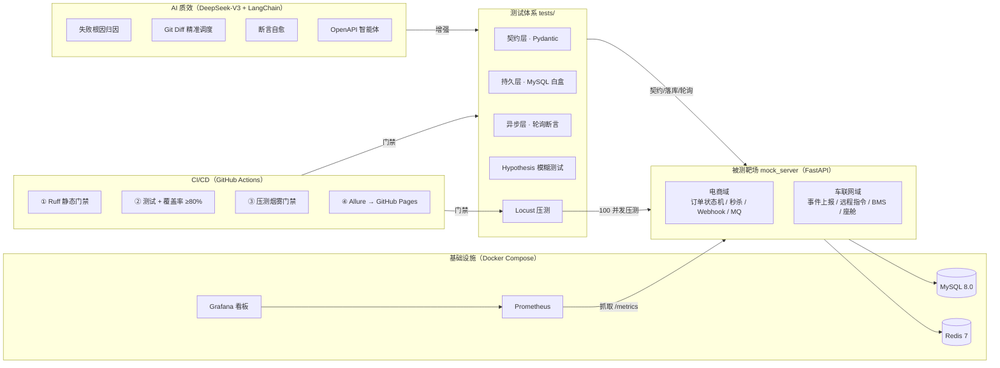
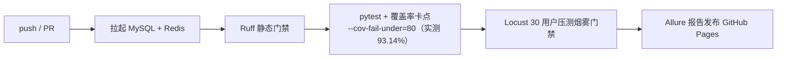

# 🚀 AutoQA-Lab：微服务全链路自动化测试与 AI 质效实验室

[](https://github.com/ARieS719/autoqa-lab/actions)
[]()
[]()
[]()
[]()

> **面向高并发交易与车联网场景的测开工程实验室**：从被测系统、三层白盒自动化、性能压测调优，到 CI 质量门禁与 LLM 质效工具，形成完整闭环。全部指标实测可复现。

---

## 📖 目录

1. [系统架构](#-系统架构)
2. [核心竞争力](#-一页看懂项目竞争力)
3. [核心模块](#-核心模块)
   - [被测靶场（电商 + 车联网双域）](#1-被测靶场电商--车联网双域)
   - [三层白盒测试体系](#2-三层白盒自动化测试体系)
   - [性能压测与瓶颈调优](#3-性能压测与瓶颈调优实测数据)
   - [CI/CD 四道质量门禁](#4-cicd-四道质量门禁)
   - [AI 质效工具链](#5-ai-质效工具链)
4. [快速开始](#-快速开始)
5. [项目目录结构](#-项目目录结构)
6. [设计决策 FAQ](#-设计决策与面试高频问答)
7. [安全声明](#️-安全声明)

---

## 🗺️ 系统架构



---

## 🎯 一页看懂项目竞争力

| 测开能力维度 | 项目落点 | 面试可展开话题 |
| :--- | :--- | :--- |
| **接口自动化** | Pydantic 契约 + MySQL 白盒落库 + 轮询断言三层体系 | 断言金字塔 / 契约测试 / 数据清理闭环 |
| **并发与幂等** | 支付 CAS 原子条件更新、10 线程并发防重实测 | 重复扣款防护 / `UPDATE ... WHERE status='PENDING'` |
| **性能测试** | Locust 混合链路压测 + slow/fast 对比实验 | 瓶颈定位方法论 / 锁 vs 服务端原子化 |
| **中间件知识** | Redis 分布式锁、Lua 原子扣减、List 模拟 MQ | 防超卖方案选型 / 最终一致性 / 削峰 |
| **安全测试** | HMAC-SHA256 验签、防重放、SQL 注入专项 | Webhook 安全 / 幂等去重 / 越权防护 |
| **CI/CD 工程化** | 四道门禁：Lint → 测试+覆盖率 → 压测 smoke → Allure | 质量红线设计 / 流水线编排 |
| **可观测性** | Prometheus 指标 + Grafana 预置看板 | 压测-监控联动定位瓶颈 |
| **AI 质效** | 失败归因 / Git Diff 调度 / 自愈引擎（无 Key 优雅降级） | ReAct / 测试提效 ROI |
| **业务域建模** | 电商 + 车联网双域（VIN 校验、指令状态机） | 车企云平台测试设计 |

---

## 🏗️ 核心模块

### 1. 被测靶场（电商 + 车联网双域）

**电商域** — 高并发交易与异步通知：

| 链路 | 关键技术 | 防御要点 |
| :--- | :--- | :--- |
| 订单状态机 | `PENDING → PAID / CANCELLED` | 支付/取消 **CAS 条件原子更新**，并发重复支付仅一人成功 |
| 秒杀防超卖 | Redis 原子库存 + Lua 脚本 | **一条 Lua 完成「检查+扣减+计数」**，无锁排队无超时；slow 模式保留分布式锁反面教材 |
| Webhook 回调 | HMAC-SHA256 验签 | 时间戳防重放（±300s）+ `SET NX` 幂等去重 + 先 ACK 后台异步流转 |
| MQ 积分发放 | Redis List 模拟队列 + Hash 账本 | 最终一致性可被轮询断言验证 |

**车联网域** — 面向车企车云平台：

| 链路 | 说明 |
| :--- | :--- |
| 车辆事件上报 | 17 位 VIN（GB 16735）强校验 + 功能域/风险等级 Literal 约束 |
| 远程指令状态机 | `PENDING → EXECUTED`，CAS 防重复执行 |
| BMS 电池告警 | 高温告警上报/检索，温度边界（-40~120℃）契约校验 |
| 座舱偏好 | 按 VIN 的 UPSERT 幂等写入 |
| 扩展位 | `charging_orders`（充电订单）、`ota_tasks`（OTA 升级）表已预留 |

> 两个业务域共用鉴权、配置中心与测试基建——验证测试框架的业务域可扩展性。

### 2. 三层白盒自动化测试体系

```
┌─ 契约层 ──── Pydantic 强校验 HTTP 响应结构与字段类型
├─ 持久层 ──── PyMySQL 穿透校验落库状态，QA_AUTO_ 前缀 + Teardown 自动清库
└─ 异步层 ──── poll_until 轮询断言 + ThreadPoolExecutor 瞬时并发冲击
```

| 测试文件 | 验证目标 | 特点 |
| :--- | :--- | :--- |
| `test_order.py` | 订单全生命周期状态机 | YAML 数据驱动 6 组边界值 |
| `test_pay_idempotency.py` | 并发支付恰 1 成功 | 10 线程 CAS 防重实测 |
| `test_concurrency_lock.py` | 10 线程抢 1 件 0 超卖 | 分布式锁/原子扣减 |
| `test_async_webhook.py` | 签名回调异步流转 | 真异步 + 轮询断言 |
| `test_mq_consistency.py` | 积分最终一致性 | 状态隔离 + 轮询 |
| `test_security.py` | 越权/伪造 Token/签名篡改/重放/SQL 注入 | 7 类安全场景 |
| `test_fuzz.py` | 200 组畸形 Payload 零 500 | Hypothesis 属性测试 |
| `test_vehicle.py` | 车联网四链路契约+落库 | 双域复用同一基建 |
| `test_asgi_coverage.py` | 进程内全分支覆盖 | CI 覆盖率确定性底座 |

**实测**：32 项用例 100% 通过 + 200 组模糊数据，服务端代码覆盖率 **93.14%**（CI 硬门禁 80%）。

### 3. 性能压测与瓶颈调优（实测数据）

**瓶颈定位**：slow 基准模式下，Locust 压测 + Grafana 监控定位两大瓶颈——**分布式锁粒度过大**（锁内包含风控阻塞 I/O，锁吞吐追不上流量到达速率）与 **`orders` 表缺少联合索引**导致全表扫描。

**调优手段**：前置无锁快速失败拦截（Fast-Fail）+ **Redis Lua 原子扣减取代应用层分布式锁** + MySQL 联合索引自愈。

| 指标（100 并发 / 60s） | 优化前 slow | 优化后 fast | 改善 |
| :--- | :---: | :---: | :---: |
| 秒杀 Med 时延 | 3200 ms | **310 ms** | 10 倍 |
| 秒杀 TP99 | 3400 ms | **480 ms** | -86% |
| 秒杀失败率 | 76.07%（578 个 500） | **0.00%** | 彻底消除 |
| 混合链路吞吐 | 75 req/s | **151 req/s** | 2 倍 |
| 超卖率 | 0% | **0%** | 账实一致 |

> 📐 **复现**：环境为 Windows + Docker Desktop（MySQL 8.0 / Redis 7 / FastAPI 单 Worker）。`docker compose up -d` → 启动靶场（默认 fast）→ `locust -f tests/locustfile.py --headless -u 100 -r 10 -t 60s --host http://127.0.0.1:8000` → `PERF_MODE=slow` 重启靶场对照。
> ⚠️ slow 的 500 是**故意保留的缺陷态**（锁内阻塞 I/O + 无前置拦截），用于复现「优化前」瓶颈，并非服务故障。

### 4. CI/CD 四道质量门禁



失败自动打印服务端日志辅助排障；AI 失败归因钩子自动介入输出诊断报告。

### 5. AI 质效工具链

| 工具 | 能力 | 降级设计 |
| :--- | :--- | :--- |
| `failure_analyzer.py` | Pytest Hook 捕获失败堆栈 + 服务端日志 → 根因诊断报告 | 无 Key 输出本地规则诊断 |
| `smart_scheduler.py` | 解析 `git diff HEAD`，LLM 精准挑选回归测试子集 | 无 Key 走关键词映射；解析失败全量兜底 |
| `openapi_tester.py` | 解析 `/openapi.json`，ReAct 智能体自主测试 + SQL 白盒核验 | 仅放行 SELECT 只读查询 |
| `self_healer.py` | 失败断言自动修复（备份 + 仅改 tests/ 护栏 + 回归重跑） | 无 Key 跳过修复 |

---

## 🚀 快速开始

### 前置要求
- Docker Desktop（提供 MySQL 8.0 / Redis 7 / Prometheus / Grafana）
- Python 3.11（仓库本地环境含 `venv`）

### ① 拉起基础设施（首启自动建 7 张表：电商 + 车联网）

```bash
docker compose up -d --wait test-db redis-cache
docker compose up -d                    # 可选：附带 Prometheus + Grafana 监控
```

### ② 启动被测靶场

```bash
venv\Scripts\python.exe -m uvicorn mock_server.app:app --host 0.0.0.0 --port 8000
# 探活 http://127.0.0.1:8000/health ｜ Swagger 文档 http://127.0.0.1:8000/docs
```

### ③ 全量测试 + 覆盖率门禁

```bash
venv\Scripts\python.exe -m pytest tests/ --cov=mock_server --cov-report=term-missing --cov-fail-under=80 --alluredir=allure-results
```

### ④ 压测实验（slow/fast 对照）

```bash
venv\Scripts\python.exe -m locust -f tests/locustfile.py --headless -u 100 -r 10 -t 60s --host http://127.0.0.1:8000
# slow 对照：$env:PERF_MODE="slow" 后重启靶场再跑同一条命令
```

### ⑤ AI 质效工具链（`.env` 配置 `OPENAI_API_KEY`，未配置自动降级）

```bash
venv\Scripts\python.exe ai_agent/smart_scheduler.py    # Git Diff 智能调度
venv\Scripts\python.exe ai_agent/openapi_tester.py     # OpenAPI ReAct 智能体
venv\Scripts\python.exe ai_agent/self_healer.py        # 断言自愈（演示见 examples/healing_demo）
venv\Scripts\python.exe ai_agent/failure_analyzer.py   # 失败归因自测
```

---

## 📂 项目目录结构

```text
autoqa-lab/
├── .github/workflows/main.yml      # CI/CD：Lint → 测试+覆盖率 → 压测 smoke → Allure 发布
├── ai_agent/                       # AI 测开提效工具链（DeepSeek-V3 + LangChain）
│   ├── failure_analyzer.py         # 失败堆栈与服务端日志智能归因
│   ├── openapi_tester.py           # OpenAPI ReAct 智能体 + SQL 白盒穿透
│   ├── self_healer.py              # 断言失效自动修复（备份 + 护栏 + 回归）
│   └── smart_scheduler.py          # Git Diff 精准回归调度（规则兜底）
├── db_init/                        # MySQL 初始化 SQL（容器 entrypoint 与服务自愈共用）
│   ├── 01_create_tables.sql        # 电商订单表 + 联合索引
│   └── 02_vehicle_tables.sql       # 车联网 6 大核心业务表
├── docs/                           # 简历素材与文档
├── examples/healing_demo/          # AI 自愈演示素材
├── grafana/                        # Prometheus 数据源 + 压测监控看板
├── mock_server/                    # FastAPI 双域被测靶场
│   ├── app.py                      # 电商域：订单/秒杀/Webhook/MQ/造数工具
│   ├── vehicle.py                  # 车联网域：事件/指令/BMS/座舱
│   └── deps.py                     # 共享依赖（DB 连接 + Token 鉴权）
├── tests/                          # 测试与压测套件（详见 tests/README.md）
├── config.py                       # 统一配置中心（pydantic-settings）
├── init_db.py                      # 一键建表脚本
├── pyproject.toml                  # Pytest + Ruff 工程化配置
├── Dockerfile                      # 靶场容器镜像
├── docker-compose.yml              # MySQL/Redis/Prometheus/Grafana 编排
├── prometheus.yml                  # 监控采集配置
└── requirements.txt                # 依赖清单（锁定版本）
```

---

## 🔧 设计决策与面试高频问答

1. **为什么支付用 `UPDATE ... WHERE status='PENDING'` 而不是「先 SELECT 再 UPDATE」？**
   SELECT-then-UPDATE 存在 TOCTOU 竞态：并发请求同时读到 PENDING 后各自 UPDATE，导致重复扣款。
   条件更新 + 检查 `rowcount`（CAS 思想）保证并发下恰好一人成功，其余 409。`test_pay_idempotency.py` 10 线程实测验证。

2. **秒杀为什么不用分布式锁？**
   锁吞吐有上限：本项目压测实测，流量到达速率超过锁吞吐后队列堆积、等锁超时（slow 模式 76% 失败率）。
   fast 模式改为「Redis 原子库存 + 前置无锁快速失败 + Lua 原子扣减」：前置拦截挡掉 99% 无效流量，
   扣减在 Redis 端单条 Lua 脚本一次往返完成，无排队无超时。**锁适合保护复杂临界区，简单计数用服务端原子化更优。**

3. **Webhook 安全做了什么？**
   HMAC-SHA256 验签（常数时间比较）、时间戳窗口（±300s）防重放、`SET NX` 幂等去重、「先 ACK 后处理」解耦支付平台超时。
   `test_security.py` 覆盖签名篡改、错误密钥、过期重放、重复回调四类攻击。

4. **为什么测试要直连数据库做白盒断言？**
   接口断言只能证明「接口说了什么」，落库断言才能证明「系统做了什么」。
   三层断言：契约层（响应结构）→ 持久层（DB 状态）→ 异步层（轮询最终一致性），
   `QA_AUTO_` 前缀 + Teardown 夹具实现脏数据自动清理闭环。

5. **AI 工具链为什么强调优雅降级？**
   生产经验：CI 流水线不能因为外部 LLM 服务抖动而红。所有 AI 能力均设计为
   「有 Key 增强、无 Key 规则兜底、解析失败全量回归」，质量红线始终可执行。

---

## ⚠️ 安全声明

本仓库为**测试教学靶场**：登录口令与 Token 为演示用途硬编码，仅用于验证鉴权链路；
生产环境必须接入真实 IAM。请勿将 `.env` 中真实密钥提交至 Git（`.gitignore` 已防护，
若密钥曾进入 Git 历史请立即在平台侧轮换）。
